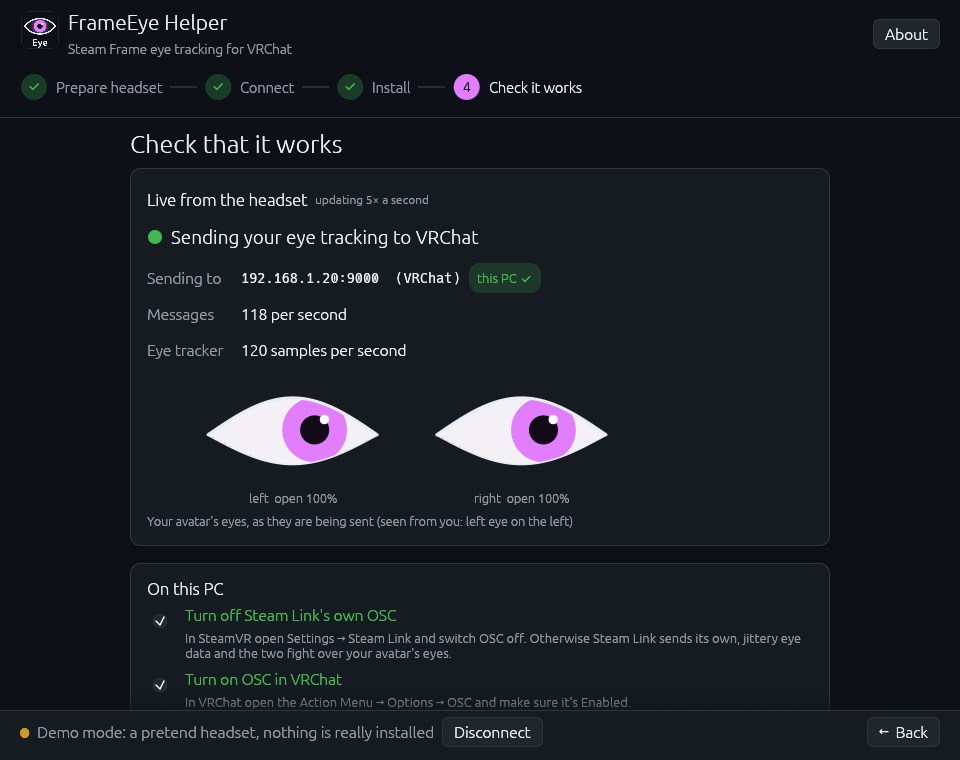
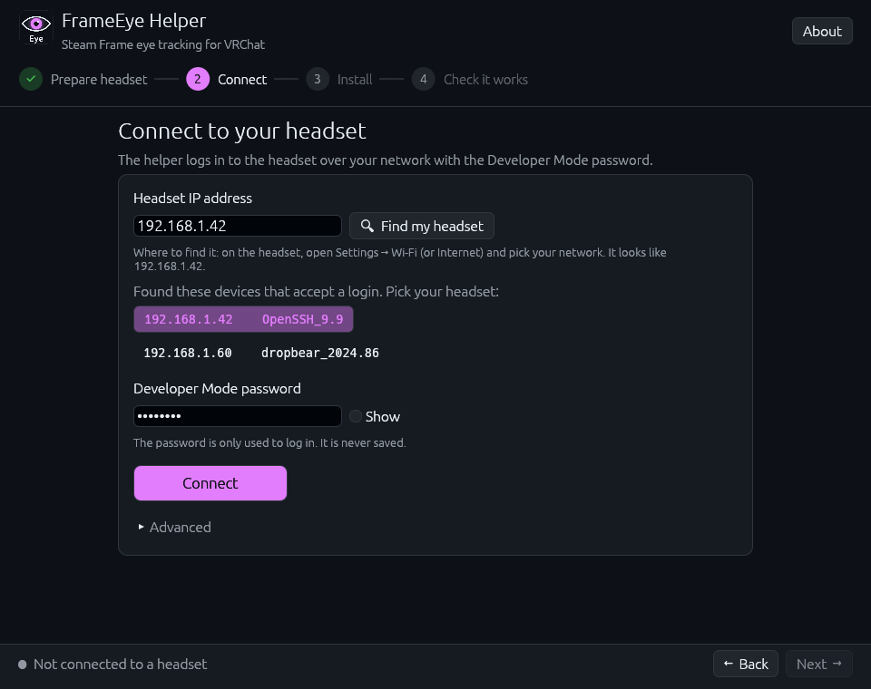
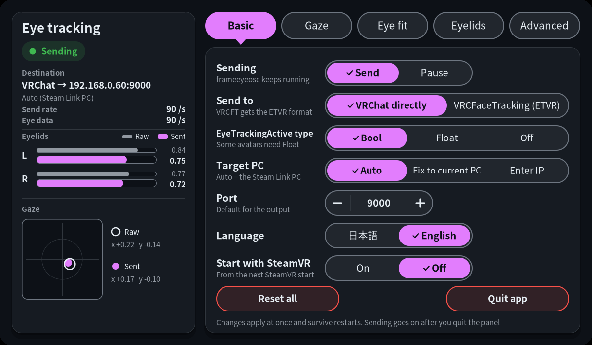

# FrameEye Helper

Steam Frame eye tracking in VRChat, without touching a terminal.



FrameEye Helper installs [frameeyeosc](https://github.com/sasaken1102r/frameeyeosc) on your Steam Frame,
so the headset's eye tracking (where you look, and your blinks) shows up on your avatar in VRChat.
Normally that means SSHing into the headset and running Linux commands. Here you type the headset's
password and click Install. After that frameeyeosc starts by itself whenever SteamVR runs, so you won't
need the app again.

## Download

Get `FrameEyeHelper-Windows.zip` from the [latest release](https://github.com/miyu0-bit/frameeye-helper/releases/latest),
unzip it and run `FrameEyeHelper.exe`. Nothing gets installed on your PC.

Windows will probably show a blue "Windows protected your PC" box because the exe isn't signed. Click
**More info**, then **Run anyway**.

There's a Linux build in the release too.

## How to use it

First, Developer Mode on the headset:

1. On the Frame, go to **Settings > System** and turn on **Developer Mode**.
2. Set a password in the new **Developer** section (and turn on SSH if there's a switch for it). Pick a
   real password, anyone on your network who knows it can log into the headset.

Then in the app:

1. **Connect**: click *Find my headset* (or type its IP), enter the password, hit Connect.
2. **Install**: one button. It copies frameeyeosc 0.5.3 over (it's built into the app, nothing gets
   downloaded), checks it arrived intact and runs frameeyeosc's own installer.
3. **Check it works**: put the headset on and stream from your PC like you normally do. The last page
   shows live whether eye data is going out, and whether it's going to this PC.



A few things on the PC side:

- Turn **off** Steam Link's own OSC (SteamVR > Settings > Steam Link > OSC), otherwise the two fight over
  your avatar's eyes.
- Turn **on** OSC in VRChat (Action Menu > Options > OSC > Enabled).
- Use an avatar with VRCFaceTracking eye parameters.

If the eyes still don't move, there's a button that adds a Windows Firewall rule for VRChat (only UDP
port 9000, only from your local network).

Once it's running you get an **Eye** panel on the SteamVR dashboard. Do the eye fit there once (Eye fit
tab, *Fit my eyes*, close the dashboard and follow the dot). Takes about 20 seconds and makes a big
difference.



## Troubleshooting

- **Couldn't reach the headset**: is it on and awake, on the same network as the PC, and is the IP right?
- **The headset isn't accepting logins**: Developer Mode or SSH isn't on yet, or there's no password set.
- **Waiting for eye data**: you have to actually wear it, it only tracks while it's on your face.
- **Avatar's eyes don't move**: check VRChat's OSC is on, try another avatar, try setting
  *EyeTrackingActive* to Float on the Eye panel's Basic tab, then try the firewall button.
- **Stopped working after a SteamOS update**: the Frame's eye data format probably changed. Update
  frameeyeosc from the Eye panel (Advanced > Check now).

The last page of the app also has a *Show headset log* section that shows what frameeyeosc is up to.

## Trying it without a headset

There's a demo mode (link on the first page) that fakes a headset so you can click through everything.

On Linux you also get a preview of the in-headset Eye panel. It runs the real frameeyeosc and its panel
in a window, fed by fake eyes that look around and blink. Space closes the fake dashboard so you can do
the eye fit and watch the dot. frameeyeosc runs in its own network namespace there, so nothing reaches
VRChat.

## Building

Everything builds inside a Fedora container, so all you need is podman:

```sh
git clone --recursive https://github.com/miyu0-bit/frameeye-helper
cd frameeye-helper
build/build-helper.sh    # tests, then FrameEyeHelper.exe and the Linux binary
build/build-preview.sh   # the Linux Eye panel preview
build/package.sh         # puts it all together in dist/
```

It's Rust, with egui for the window and russh for SSH. Every command it runs on the headset is in
[helper/src/remote.rs](helper/src/remote.rs) if you want to see exactly what it does. There's also a fake
Steam Frame for testing, see [docs/testing.md](docs/testing.md).

## Credits

The actual eye tracking is all [frameeyeosc](https://github.com/sasaken1102r/frameeyeosc) by sasaken1102r,
which builds on [konsti219's original](https://github.com/konsti219/frameeyeosc) (the one that figured out
where the Frame keeps its eye data). This app just installs it. The Eye icon comes from frameeyeosc's panel.

Not affiliated with Valve, VRChat, VRCFaceTracking or the frameeyeosc authors. frameeyeosc reads data the
Frame doesn't officially expose, so have a look at the disclaimer in its README before using it.

## License

MIT, see [LICENSE](LICENSE). frameeyeosc is MIT too. Licenses of everything built into the binaries are in
[THIRD_PARTY_LICENSES.md](THIRD_PARTY_LICENSES.md).
